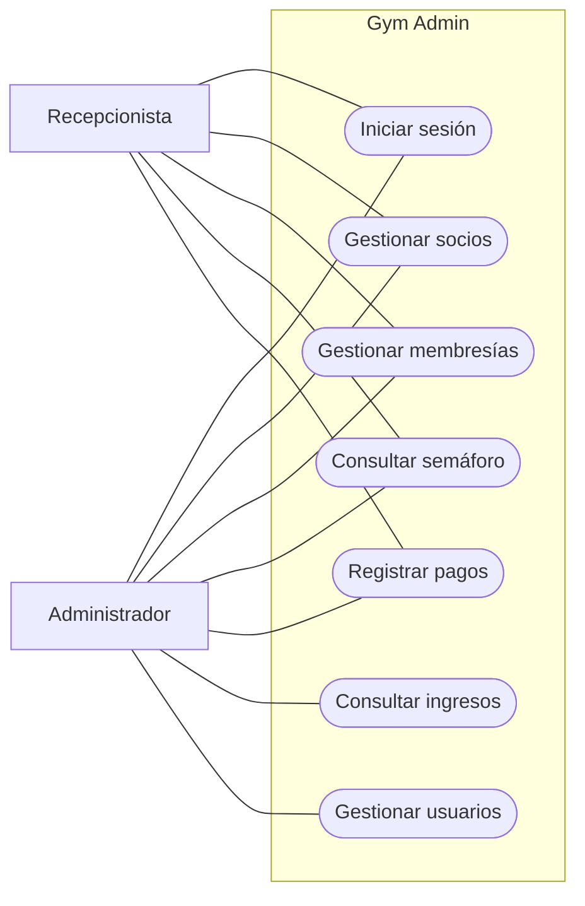

# Diagrama de Casos de Uso

## Sistema de Administración de Gimnasio (Gym Admin)

Representación de las funcionalidades del sistema y su relación con los usuarios autorizados.

## Descripción de los actores

### Administrador
Tiene acceso a la administración general del gimnasio, la consulta de ingresos y la gestión de usuarios.

### Recepcionista
Realiza las operaciones cotidianas del gimnasio, incluyendo el registro de socios, la gestión de membresías, el registro de pagos y la consulta del semáforo.

