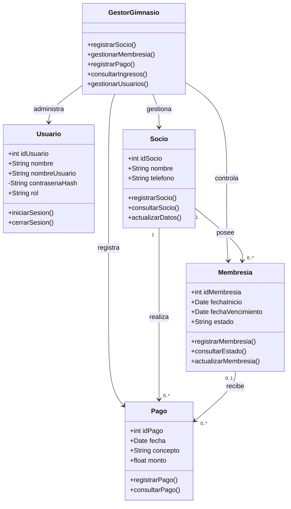

# Diagrama de Clases

## Sistema de Administración de Gimnasio (Gym Admin)

El siguiente diagrama presenta el diseño de clases basada en los requisitos funcionales del sistema.

## Descripción de las clases

### Usuario
Representa las cuentas autorizadas del sistema y permite identificar al administrador y al recepcionista mediante sus credenciales y roles.

### Socio
Almacena los datos de los socios registrados y permite consultar o actualizar su información.

### Membresia
Controla las fechas de inicio y vencimiento de las membresías, así como su estado.

### Pago
Representa los pagos registrados en el gimnasio, incluyendo fecha, concepto y monto.

### GestorGimnasio
Coordina las operaciones principales del sistema y permite gestionar socios, membresías, pagos, usuarios e ingresos.

