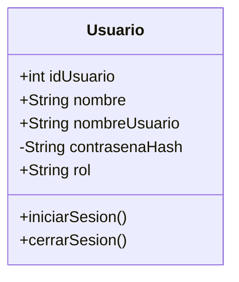
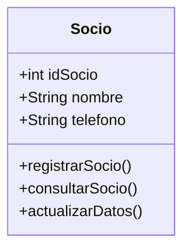
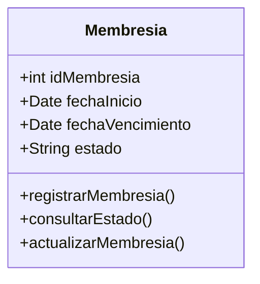
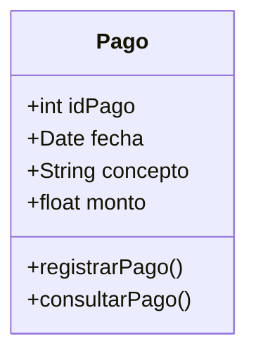
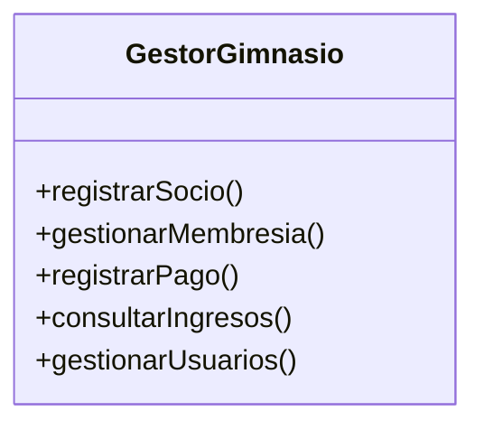

# Diagramas Individuales de Clases

## Sistema de Administración de Gimnasio (Gym Admin)

Los siguientes diagramas representan individualmente las cinco clases propuestas para el sistema, mostrando sus atributos y métodos.

## 1. Clase Usuario

## 2. Clase Socio

## 3. Clase Membresia

## 4. Clase Pago

## 5. Clase GestorGimnasio

