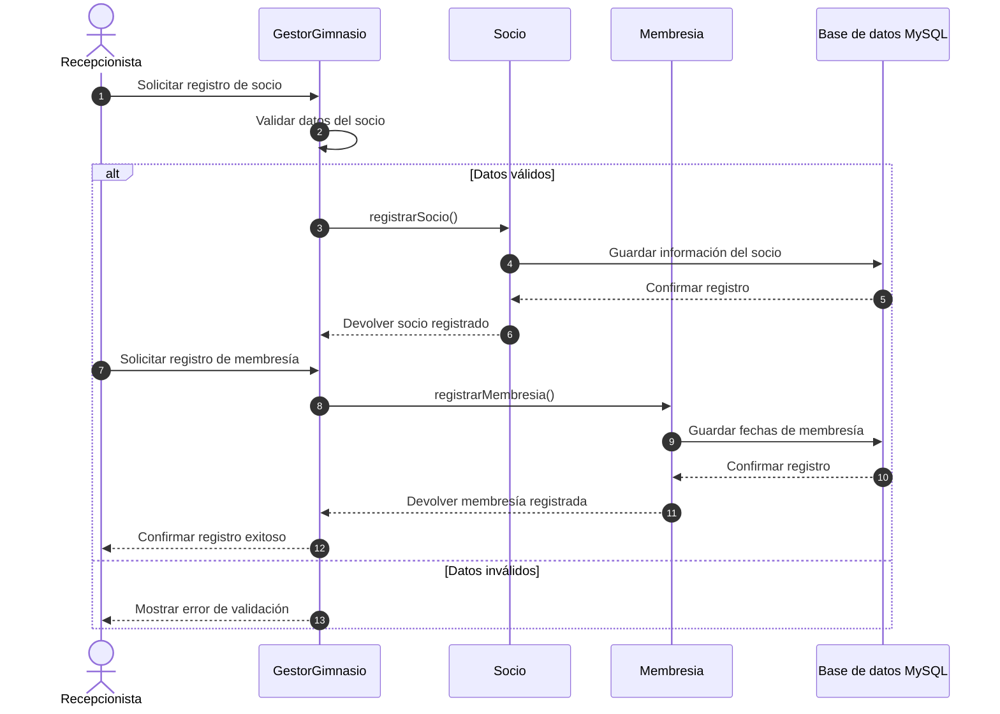

# Diagrama de Secuencia

## Sistema de Administración de Gimnasio (Gym Admin)

### Registro de socio y membresía

El siguiente diagrama representa la interacción entre el recepcionista y los componentes del sistema durante el registro de un nuevo socio y su membresía.

## Descripción del proceso

### 1. Solicitud de registro
El recepcionista inicia el proceso proporcionando los datos del nuevo socio.

### 2. Validación de información
El sistema verifica que los datos necesarios para el registro sean válidos.

### 3. Registro del socio
La clase GestorGimnasio coordina el registro mediante el método registrarSocio() de la clase Socio.

### 4. Registro de membresía
Una vez registrado el socio, se utiliza el método registrarMembresia() para almacenar las fechas de inicio y vencimiento.

### 5. Almacenamiento de información
Los datos del socio y de su membresía se guardan en la base de datos MySQL.

### 6. Confirmación
El sistema informa al recepcionista que el registro se completó correctamente.
