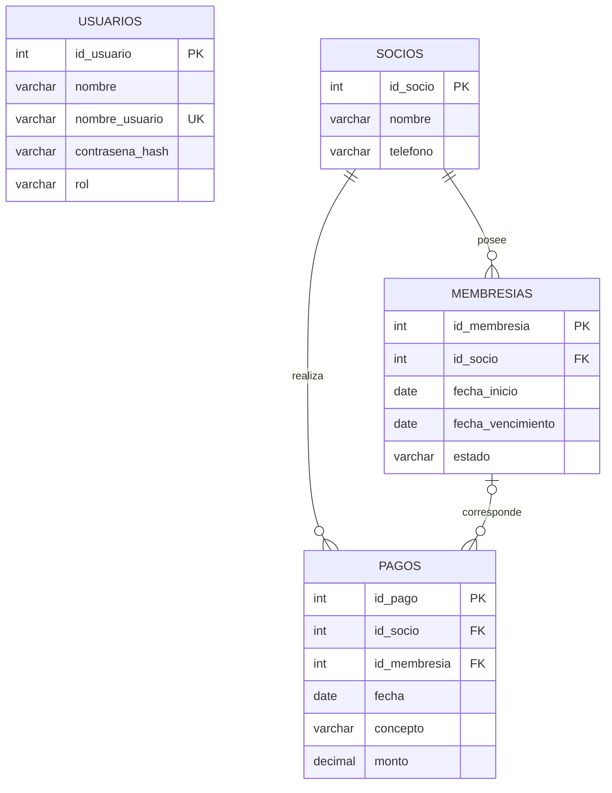

# Diagrama Entidad-Relación

## Sistema de Administración de Gimnasio (Gym Admin)

El siguiente diagrama representa el diseño de la base de datos relacional del sistema Gym Admin, utilizando MySQL.



## Descripción de las entidades

### 1. Usuarios
Almacena las cuentas de acceso del administrador y del recepcionista, incluyendo sus credenciales y rol.

### 2. Socios
Contiene la información de las personas inscritas en el gimnasio.

### 3. Membresías
Registra las fechas de inicio y vencimiento de las membresías de cada socio, así como su estado.

### 4. Pagos
Almacena los pagos realizados por los socios, incluyendo fecha, concepto y monto.

## Relaciones

- **Socios - Membresías (1:N):** un socio puede tener varias membresías registradas a lo largo del tiempo. Cada membresía pertenece a un solo socio.
- **Socios - Pagos (1:N):** un socio puede realizar varios pagos. Cada pago corresponde a un solo socio.
- **Membresías - Pagos (1:N opcional):** una membresía puede estar relacionada con varios pagos. Un pago puede asociarse a una membresía o no tener una membresía asociada.
```
